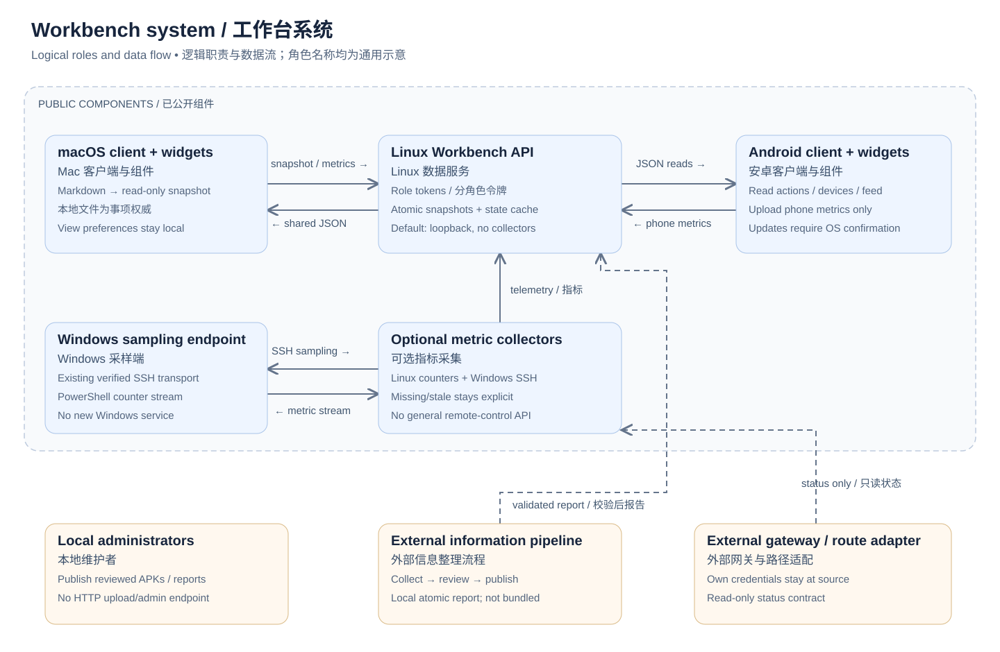
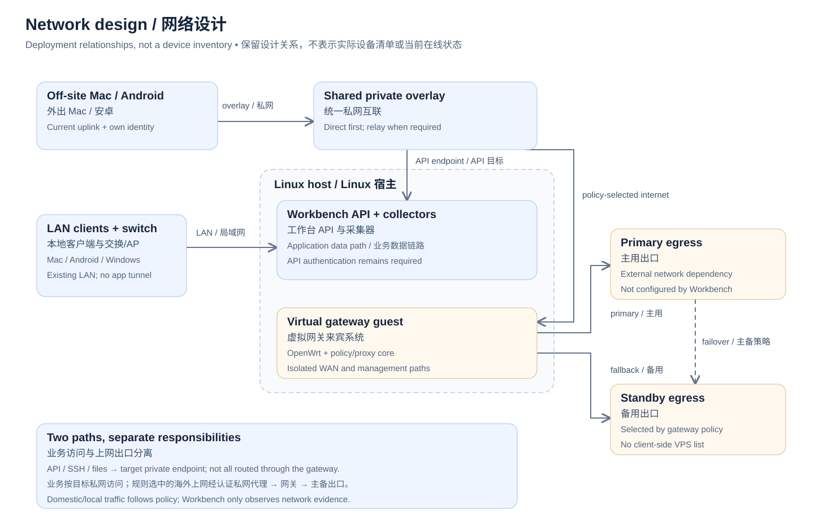

# Workbench architecture

[English](ARCHITECTURE.md) · [简体中文](ARCHITECTURE.zh-CN.md)

This document describes the system behind the unified workbench and identifies which parts are present in this repository. It uses generic roles, not an inventory of a live network. It accompanies the [2.2.0 application release](https://github.com/moxingddyp/action-desk/releases/tag/v2.2.0); the diagrams do not establish that an arbitrary new deployment has been tested.

## 1. System and source boundaries

| Role | Responsibility | Public implementation |
| --- | --- | --- |
| macOS application | Project the user's Markdown work plan, display actions/devices/information, upload Mac metrics, persist view preferences | [native/](../native/) |
| macOS widgets | Read the host's local caches; open or change presentation through the public app's intents and URL scheme | [Widget.swift](../native/Widget.swift), [DeviceWidget.swift](../native/DeviceWidget.swift) |
| Android application/widgets | Read the same service snapshots/report, upload available phone metrics, verify an update before opening the OS installer | [android/](../android/) |
| Linux Workbench API | Authenticate by role, validate and atomically store snapshots, merge timestamped metrics, serve reports and reviewed Android packages | [service/](../service/) |
| Linux/Windows collectors | Collect available local Linux counters and a Windows PowerShell metric stream over existing verified SSH access | [linux_telemetry.py](../service/linux_telemetry.py), [windows_telemetry.ps1](../service/windows_telemetry.ps1) |
| Information preparation/publishing | Collect public sources, retain provenance, deduplicate/review, validate and publish a report independently of the Mac | External integration; its account sessions, source inventory, agent setup and schedules are not distributed |
| Gateway, overlay and egress | Provide encrypted reachability, routing and optional status evidence | External infrastructure; the public service exposes opt-in adapter contracts, not a gateway installer |

Solid system-diagram connections connect distributed application roles. Dashed connections cross to external integrations. Coloured external boxes are architectural context, not additional bundled software. A local administrator may publish reviewed report or update files; the Workbench HTTP API has no general administration, report-upload, APK-upload or shell-execution endpoint.

## 2. Network and deployment relationships

The reference deployment separates a Linux application host from a virtual OpenWrt gateway guest on that host. The gateway has distinct WAN and local/management relationships. Physical interface names, namespaces, routes, addresses and provider details belong to the operator's configuration and are not part of this diagram or distribution.

An existing Tailscale private overlay connects desktop, phone, workstation, server and gateway roles. Desktop/phone connectivity can use sing-box clients with an embedded overlay endpoint; workstation/server/gateway roles can use their native overlay clients. These are external components with their own authentication and lifecycle. Workbench does not install them, copy their identities, create a separate tunnel, or change their configuration.

Two traffic paths must remain distinct:

1. **Application and device access:** a client reaches the Workbench API or a permitted SSH/file endpoint at that target's private address. An available LAN path can be used locally. Overlay transport prefers a direct connection when possible and otherwise uses a supported relay. The gateway is not a mandatory application-data relay.
2. **Policy-selected internet access:** traffic selected by the existing routing policy reaches an authenticated private proxy at the gateway, which selects the primary or standby external egress. Local/domestic traffic follows the operator's direct policy. Client configurations need not contain the external VPS inventory. Failover is owned by the gateway policy, not by Workbench.

Overlay reachability is not API authorization. A green overlay membership indicator is not evidence of a direct path, a working internet exit, LAN presence, or fresh hardware measurements. Workbench displays those observations separately, with their own timestamps and expiry. Private IP reachability also does not establish broadcast discovery or wake-from-sleep support.

## 3. Data flow and ownership

| Flow | Origin → processing → consumer | Authority and failure behavior |
| --- | --- | --- |
| Work plan | Local Markdown → Mac projection → authenticated snapshot write → Linux cache → Mac/Android views | Markdown remains authoritative. Invalid, older or hash-damaged packets do not replace a valid snapshot. Local view selections do not update task status. |
| Metrics | Mac/phone uploads plus explicitly enabled Linux/Windows collectors → merged service response → client caches/widgets | Server reception and network observation times are separate. Missing counters remain absent; stale samples remain marked stale. |
| Daily information | External public-source collection → provenance/context review and deduplication → report validation → atomic local publication → information API | The reference workflow runs preparation and publication independently on Linux. Mac sleep does not make it a processing relay. The bundled API reads the published report; it is not the collection/review agent. |
| Update package | Local maintainer reviews package/metadata → atomic release store → authenticated manifest/download → client validation → OS confirmation | Hash, size, package, version and certificate checks precede installation. No silent installation or public upload endpoint is provided. |
| Optional completion receipt | External publisher → durable receipt → existing local coordination process | Describes an integration pattern; coordination agents, private receipt queues and chat delivery are not shipped. Publishing need not wait for Mac connectivity. |

The service can derive the 48-hour action classification from the snapshot's supplied activity evidence without pretending that it edited the source plan or made new work progress. Application caches are display copies, not a second editable task database.

## 4. Authorization and write boundaries

| Credential or access | Allowed | Does not grant |
| --- | --- | --- |
| `readToken` | All supported GET endpoints: health, actions, telemetry, information, Android manifest/package | Any HTTP write; it is a broad read role, not a per-item permission system |
| `actionsToken` | `PUT /v1/actions`, subject to snapshot validation | Read access, device uploads, arbitrary filesystem writes |
| `macToken` | `PUT /v1/mac` with permitted Mac metric fields | Action writes, phone writes or read access |
| `phoneToken` | `PUT /v1/phone` with validated phone metric fields | Action/Mac writes or read access |
| Local report/package maintainer | Write reviewed files through explicit local tools and filesystem access | An HTTP admin interface or automatic execution of source content |
| Collector/adapter process | Operator-authorized metric reads over existing local/SSH mechanisms | An application API for general device control |

Generate a **different random value for each role**. The implementation compares the presented bearer token to the token configured for that endpoint; reusing one value for multiple roles collapses that separation. The phone import deliberately rejects Mac/action publishing credentials. The read role can reveal the entire plan, feed and device report, so a user must only distribute it to intended readers.

Gateway adapters are administrator-supplied commands with a read-only output contract; they are not sandboxed by a claim that a command is read-only. Review them and their operating-system permissions before enabling. The adapters retain their own source authentication. The public repository includes no controller credential, SSH key, household topology, routing rule deployment or private gateway command.

## 5. Configuration and reproducibility

The shipped [service configuration template](../service/config.example.json) binds loopback and enables no collector or remote command. Follow the [service guide](../service/README.md) to generate independent role tokens and select a private state directory outside the checkout. For network access, explicitly configure a local encrypted-overlay bind and private-bind opt-in; the API does not provide TLS itself. A client can use HTTPS through an operator-managed TLS endpoint, or HTTP restricted by the clients to loopback/CGNAT private-overlay origins. Do not place the HTTP service on a public interface.

Use the [Mac projection configuration](../examples/config.example.json) for your source directory and own chat UUID, and the [Mac service template](../examples/client.example.json) for the API origin and Mac/read/action roles. The [phone template](../android/connection.example.json) contains only the read/phone roles. Token placeholders and fictional addresses are examples, not working access credentials. Keep filled configurations and all signing material outside the repository; the clients validate configured origins and refuse service redirects while attaching credentials.

A minimal sequence is: start the loopback API with private configuration; verify authorized reads and unauthorized rejection; configure the Mac projection and its separate service connection; import the phone-only connection; then explicitly enable the needed metric collectors and separately reviewed gateway adapters. Fill the information report through your own local publisher. Missing optional integrations must display unavailable/unknown, not fabricated defaults. No new network infrastructure is required by the application itself.

## 6. Public evidence and limits

The [2.2.0 release](https://github.com/moxingddyp/action-desk/releases/tag/v2.2.0) provides Mac DMG/ZIP, Android APK, a source archive and checksums. The source includes fictional examples. The [verification scope](ACCEPTANCE.md) records build, signature, synthetic model and loopback checks and their limits. New-machine WidgetKit installation, public-APK installation, a new operator's full multi-device/gateway setup and long-term behavior remain unverified for the public adaptation.

This architecture update changes documentation and editable diagrams only. It does not modify the 2.2.0 application binaries or their checksums. The 2.2.0 source archive remains the source snapshot for that release; these newer architecture pages are available from the repository history. Private information collection/agent orchestration and gateway deployment are described by role and data contract, not silently added to the open-source implementation.
