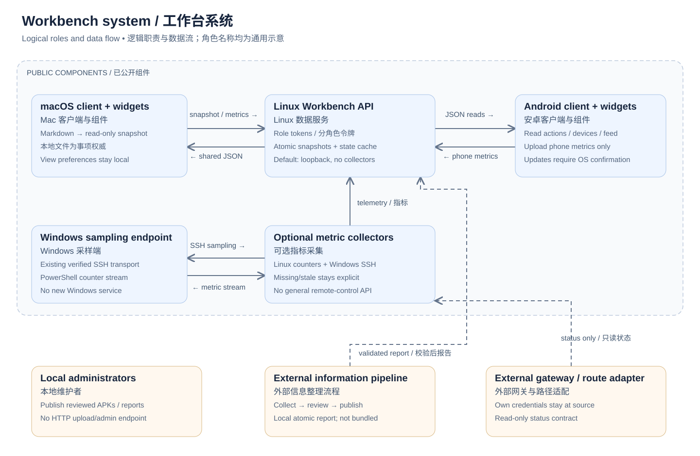
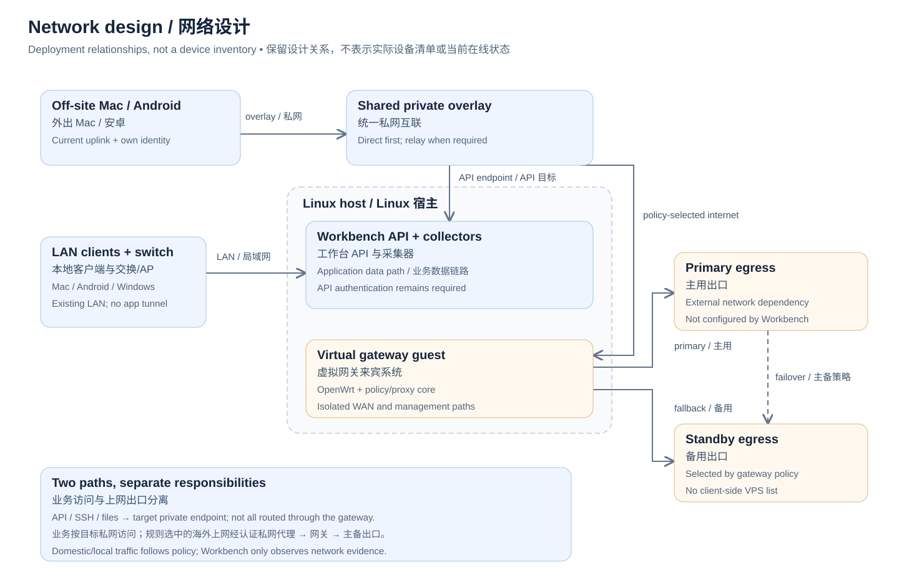

# 工作台系统与网络架构

[English](ARCHITECTURE.md) · [简体中文](ARCHITECTURE.zh-CN.md)

本文说明统一工作台背后的系统关系及本仓库实际包含的实现。图中使用通用角色，不表示实际网络设备清单。说明配套于 [2.2.0 应用发布](https://github.com/moxingddyp/action-desk/releases/tag/v2.2.0)，不据此声称任意新部署均已验收。

## 1. 系统及源码边界

| 角色 | 职责 | 公开实现 |
| --- | --- | --- |
| Mac 应用 | 将用户 Markdown 清单投影为事项，展示行动/设备/信息，上报 Mac 指标，保存展示偏好 | [native/](../native/) |
| Mac 小组件 | 读取宿主本地缓存，通过开源应用的意图和 URL 入口打开页面或调整展示 | [Widget.swift](../native/Widget.swift)、[DeviceWidget.swift](../native/DeviceWidget.swift) |
| 安卓应用及组件 | 读取同一份快照和报告，上报可取得的手机指标，核验更新后交系统安装器确认 | [android/](../android/) |
| Linux 工作台 API | 按角色鉴权，校验并原子保存快照，合并带时间的指标，分发报告和审核后的安卓包 | [service/](../service/) |
| Linux/Windows 采集器 | 取得本机 Linux 指标，通过已有且核实身份的 SSH 连接读取 Windows PowerShell 指标流 | [linux_telemetry.py](../service/linux_telemetry.py)、[windows_telemetry.ps1](../service/windows_telemetry.ps1) |
| 信息准备与发布流程 | 采集公开来源、保留证据、去重审阅、校验发布，独立于 Mac 执行 | 外部集成；不分发账号会话、订阅清单、Agent 配置或定时计划 |
| 网关、私网与上网出口 | 提供加密可达性、路由和可选状态证据 | 外部基础设施；公开服务提供按需启用的适配契约，不包含网关安装器 |

系统图实线连接已分发的应用角色，虚线跨向外部集成。外部配色框用于解释架构，不代表另有配套软件已打包。本地维护者可发布已审核的报告和安装包；工作台 HTTP API 没有通用管理、报告上传、APK 上传或执行任意命令的接口。

## 2. 网络与部署关系

参考部署中，Linux 宿主运行应用服务，并承载独立的 OpenWrt 虚拟网关来宾系统。网关 WAN 与本地/管理链路分别组织。网卡名、命名空间、路由、地址和供应商参数由使用者自行配置，不进入本图或公开分发包。

已有 Tailscale 私网连接桌面、手机、工作站、服务器和网关这些角色。桌面/手机可通过嵌入私网端点的 sing-box 客户端接入，工作站/服务器/网关可使用原生私网客户端。它们是拥有独立认证和生命周期的外部组件；工作台不安装这些组件、不复制身份、不另建隧道，也不修改其配置。

需要分别理解两条链路：

1. **应用与设备访问**：客户端直接访问目标设备私网地址上的工作台 API，或被允许的 SSH/文件接口。在本地可以使用可达的 LAN 路径；私网传输优先尝试直连，不能直连时使用受支持的中继。网关不是所有业务数据的必经转发点。
2. **规则选中的上网流量**：由既有路由策略选中的流量进入网关上的认证私网代理，再由网关选择主用或备用外部出口。本地/国内流量按使用者的直连策略处理，客户端不必携带外部 VPS 节点清单。主备切换由网关策略负责，工作台不负责切换。

私网可达不代替 API 认证。私网成员在线不等于链路直连、上网出口健康、LAN 当前在线或硬件指标新鲜；工作台分别显示这些观测及其时间和有效期。私网 IP 可达也不证明广播发现、休眠唤醒等功能成立。

## 3. 数据流与权威归属

| 数据流 | 来源 → 处理 → 使用端 | 权威与失败行为 |
| --- | --- | --- |
| 工作清单 | 本地 Markdown → Mac 投影 → 带鉴权快照写入 → Linux 缓存 → Mac/安卓展示 | Markdown 保持权威；无效、过旧或哈希损坏的包不替换有效快照；本地展示切换不修改任务状态。 |
| 设备指标 | Mac/手机上报与显式启用的 Linux/Windows 采集 → 服务合并 → 客户端缓存/组件 | 服务接收时间与网络观测时间分别维护；取不到的指标留空，过期明确显示。 |
| 每日信息 | 外部公开信息采集 → 证据/上下文审阅与去重 → 报告校验 → 本地原子发布 → 信息 API | 参考流程由 Linux 独立准备与发布，Mac 休眠不使其成为接力处理依赖；公开 API 只读已发布报告，不是采集审阅 Agent。 |
| 安装更新 | 本地维护者审核 APK/元数据 → 原子发布存储 → 带鉴权清单/下载 → 客户端核验 → 系统确认 | 安装前检查哈希、大小、包名、版本和证书；没有静默安装或公网上传入口。 |
| 可选完成回执 | 外部发布程序 → 持久化回执 → 已有本地协调流程 | 描述集成方式，不附带协调 Agent、私有队列或聊天投递；发布本身不必等待 Mac 在线。 |

服务可依据快照提供的行动活跃证据计算 48 小时分类，但不据此声称修改了源清单或产生了新的工作推进。应用缓存是展示副本，不是第二套可编辑任务数据库。

## 4. 认证与写入边界

| 凭据或访问方式 | 允许 | 不授予 |
| --- | --- | --- |
| `readToken` | 全部受支持的 GET：健康、事项、遥测、信息、安卓清单及安装包 | 任何 HTTP 写入；它是宽范围读角色，没有逐事项授权。 |
| `actionsToken` | 经快照校验的 `PUT /v1/actions` | 读取、设备上报、任意文件写入。 |
| `macToken` | 仅允许字段的 `PUT /v1/mac` | 修改事项、写手机指标或读取。 |
| `phoneToken` | 经字段校验的 `PUT /v1/phone` | 修改事项/Mac 指标或读取。 |
| 本地报告/安装包维护者 | 通过明确的本地工具及文件权限写入审核后的文件 | HTTP 管理接口，或自动执行来源内容。 |
| 采集器/适配进程 | 使用者授权的本机或 SSH 指标读取 | 面向客户端的通用设备控制 API。 |

**每个角色必须使用不同的随机令牌**。程序将请求中的 Bearer token 与该端点配置值比较；多个角色复用同一个值会使权限分离失效。手机导入明确拒绝 Mac/事项发布凭据。读角色能看到完整清单、信息和设备报告，应只发给预期读者。

网关适配器是维护者自行配置、遵守只读输出契约的命令；“只读”描述不等于进程已被沙盒强制隔离，启用前须审核命令及操作系统权限。来源认证保留在适配器自己的运行端。本仓库不附带控制器凭据、SSH 密钥、家庭拓扑、路由部署或私有网关命令。

## 5. 配置与复现入口

现有[服务配置模板](../service/config.example.json)默认只监听本机，全部采集器和远程命令关闭。按[服务说明](../service/README.md)生成独立角色令牌，将私有状态放在仓库之外。联网使用时明确配置本机加密私网地址并开启私网绑定许可；API 自身不提供 TLS。客户端可接使用者维护的 HTTPS 终结点，或仅对回环/CGNAT 私网来源使用 HTTP；不要让 HTTP 服务监听公网接口。

使用 [Mac 投影配置](../examples/config.example.json)填写自己的源目录和对话 UUID，使用 [Mac 服务配置](../examples/client.example.json)填写 API 来源和 Mac/读取/事项角色，手机只使用[手机配置模板](../android/connection.example.json)中的读取及手机角色。占位令牌、虚构地址不能直接访问任何实际部署。填好的配置及所有签名材料保存在仓库外；客户端校验连接来源，携带鉴权时不跟随服务重定向。

最小接入顺序：用私有配置启动回环 API，检查带授权读取及无授权拒绝；配置 Mac 本地投影及独立服务连接；导入仅手机角色的连接文件；再显式启用所需采集器及单独审核的网关适配。信息报告由使用者自己的本地发布器写入。缺少可选集成时应显示未知/不可用，不用默认数据补齐。应用本身不要求新建网络基础设施。

## 6. 公开证据与实际限制

[2.2.0 Release](https://github.com/moxingddyp/action-desk/releases/tag/v2.2.0)提供 Mac DMG/ZIP、安卓 APK、源码压缩包与校验和；源码含虚构示例。[验收范围](ACCEPTANCE.zh-CN.md)说明构建、签名、合成模型与回环检查及其限制。公开适配尚未完成新机器 WidgetKit 首次安装、公开 APK 真实安装、新使用者全设备/网关接入和长期运行验收。

本次仅修改说明及可编辑图示，不改变 2.2.0 二进制或其校验和。2.2.0 源码附件仍对应该版本冻结快照；更新后的架构说明位于仓库历史中。私人信息采集/Agent 编排和网关部署只按职责、数据契约解释，不默认扩大为本次开源实现。
